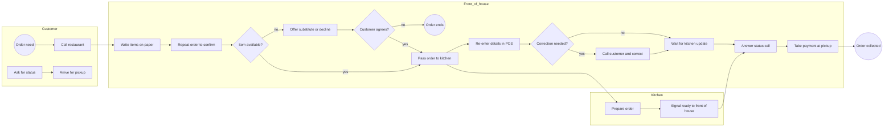

# As-Is Process — Phone Pickup Order

## Purpose and boundary

This is a discovery hypothesis for a fictional restaurant: from a customer's phone call to pickup and payment. Validate task order and exception frequency by observing staff before treating it as an actual baseline.

## Risks to validate

- Is the order repeated back, and does the kitchen receive the same paper/POS representation?
- How are substitutions and unavailable items agreed and recorded?
- How often are correction calls and status calls made per 100 orders?
- Which system is the source of truth for order state?
- What happens when staff are too busy to answer the phone?
