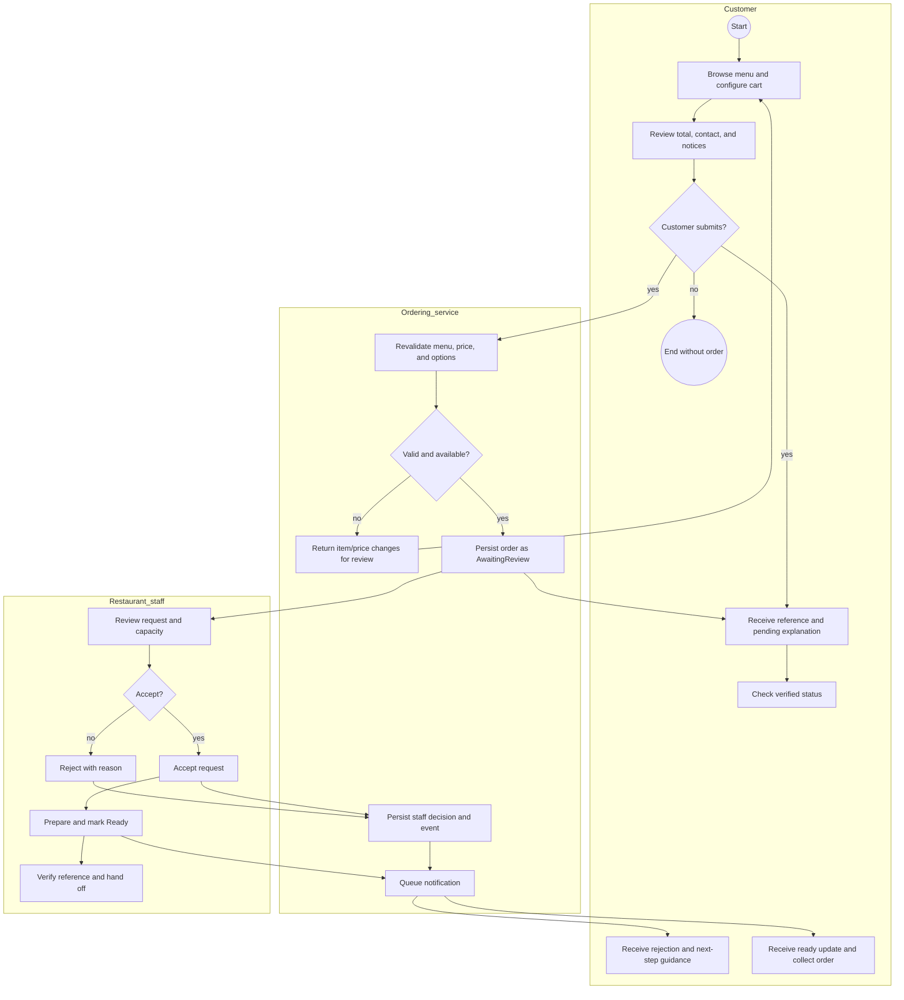

# To-Be Process — Online Request and Staff Decision

## Proposed first-release workflow

## BPMN-style interpretation

- Start and end circles represent process start/end events.
- Rectangles represent tasks performed by a participant.
- Diamonds represent exclusive decisions with labeled outcomes.
- The three lanes separate customer, service, and restaurant responsibility.
- Notification is a queued service task; provider delivery is an external dependency and can fail without undoing the order state.
